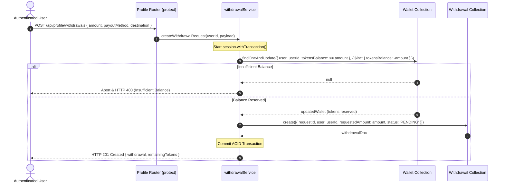
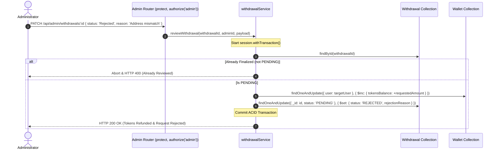

# STEP 11 Phase 2A: Withdrawals & Redemptions Engine

## 1. Architectural Overview & Scope

Step 11 Phase 2A establishes persistent platform withdrawal management by integrating the frontend withdrawal UI components with authenticated backend services, MongoDB Atlas persistence, and multi-document ACID transaction safety.

### Crucial Financial Restriction
> [!IMPORTANT]
> **Real-Money Payouts Remain Strictly Disabled.**
> In Phase 2A, the system functions as an **infrastructure reservation and administrative review engine**.
> - The Token/USD exchange rate is unapproved and undefined.
> - No fiat or cryptocurrency funds are moved.
> - No third-party payment gateways (Stripe, PayPal, Tango Card, Tremendous) or crypto RPC nodes are integrated.
> - An approved request records an administrative status change (`APPROVED`); it is **never marked as paid or completed**.
> - The canonical `CRYPTO_SWAP` achievement is intentionally deferred until live external payout settlement is implemented.

---

## 2. Withdrawal Data Model (`backend/models/Withdrawal.js`)

The `Withdrawal` model represents individual payout submissions and token balance reservations.

### Schema Fields

| Field Name | Type | Validation / Rules | Description |
| :--- | :--- | :--- | :--- |
| `requestId` | `String` | Required, unique, trimmed, uppercase | Unique server-generated human-readable identifier (e.g. `W-1001`). |
| `user` | `ObjectId` | Required, ref: `'User'`, indexed | Reference to the authenticated User submitting the request. |
| `requestedAmount` | `Number` | Required, `min: 0.01` | Exact platform token quantity requested and reserved. |
| `asset` | `String` | Enum: `['tokens', 'ves']`, default: `'tokens'` | Platform reward asset being withdrawn. |
| `feeAmount` | `Number` | `min: 0`, default: `0` | Reserved for future fee policy (0 in Phase 2A infrastructure mode). |
| `netAmount` | `Number` | `default: requestedAmount - feeAmount` | Net tokens reserved for the request. |
| `payoutCurrency` | `String` | Optional, default: `null` | Payout currency name (uncalculated without approved exchange rate). |
| `payoutMethod` | `String` | Enum: `['USDC_POLYGON', 'USDT_TRON', 'PAYPAL', 'BANK_ACH', 'OTHER']` | Destination payment channel selected by user. |
| `destination` | `String` | Trimmed, max 255 chars, default: `''` | Sanitized destination address, public key, or account email. |
| `status` | `String` | Enum: `['PENDING', 'APPROVED', 'REJECTED']`, default: `'PENDING'` | Lifecycle state of the request. |
| `rejectionReason` | `String` | Trimmed, max 500 chars, default: `null` | Mandatory explanation provided by admin when rejecting. |
| `reviewedBy` | `ObjectId` | Ref: `'User'`, default: `null` | Administrator who reviewed the request. |
| `reviewedAt` | `Date` | Default: `null` | Timestamp when review decision was recorded. |
| `timestamps` | `Boolean` | `true` | Automatically tracks `createdAt` and `updatedAt`. |

### Database Indexes
- `{ requestId: 1 }`: Unique index preventing duplicate request IDs across the system.
- `{ user: 1, createdAt: -1 }`: Optimizes user history pagination and summary aggregations.
- `{ status: 1, createdAt: -1 }`: Optimizes administrative filtering by review queue status.

---

## 3. Balance Reservation & MongoDB Transaction Safety

Every operation that mutates balances or updates withdrawal lifecycles runs inside an atomic MongoDB multi-document ACID transaction using `session.withTransaction()`.

### Flow 1: Withdrawal Request Creation (`POST /api/profile/withdrawals`)

1. **Server-Side Validation:** The requested amount is validated on the backend. Zero, negative, non-numeric, and non-finite values are rejected with HTTP 400.
2. **Conditional Reservation:** Tokens are deducted using `{ user: userId, tokensBalance: { $gte: roundedAmount } }`. If the user has insufficient tokens or fires concurrent requests, only the request with sufficient balance can succeed.
3. **Atomicity:** The token reservation and `PENDING` withdrawal creation succeed together or abort completely.

---

### Flow 2: Administrative Rejection & Automatic Refund (`PATCH /api/admin/withdrawals/:id`)

1. **Mandatory Reason:** A non-empty justification string (at least 3 characters) is enforced server-side.
2. **Single-Refund Guarantee:** The update checks `{ _id: id, status: 'PENDING' }`. If another concurrent administrator already rejected or approved the request, the query matches 0 documents and avoids duplicate refunds.
3. **Atomic Refund:** The token credit back to `Wallet.tokensBalance` and the status transition to `REJECTED` are committed in the same transaction.

---

### Flow 3: Administrative Approval (`PATCH /api/admin/withdrawals/:id`)

1. Validates status transition from `PENDING` to `APPROVED`.
2. Updates `status: 'APPROVED'`, `reviewedBy: adminId`, and `reviewedAt: new Date()`.
3. Tokens remain deducted from the user's wallet.
4. **No real-money payout is dispatched.**
5. `CRYPTO_SWAP` achievement is NOT unlocked in Phase 2A.

---

## 4. REST API Endpoint Specifications

### User Profile Endpoints (Require Bearer JWT)

| Method | Endpoint | Description | Response Envelope |
| :--- | :--- | :--- | :--- |
| `POST` | `/api/profile/withdrawals` | Submits withdrawal request and reserves tokens. | `{ success: true, message, withdrawal: { ... }, remainingTokens }` |
| `GET` | `/api/profile/withdrawals` | Retrieves paginated user withdrawal records. | `{ success: true, data: [ ... ], pagination: { total, page, limit, pages } }` |
| `GET` | `/api/profile/withdrawal-summary` | Returns user payout summary metrics. | `{ success: true, totalRequests, pendingCount, pendingAmount, approvedCount, approvedAmount, rejectedCount, rejectedAmount, successfullyWithdrawnAmount, currency }` |

### Admin Endpoints (Require Bearer JWT + `role: 'admin'`)

| Method | Endpoint | Description | Query / Body Payload |
| :--- | :--- | :--- | :--- |
| `GET` | `/api/admin/withdrawals` | Lists all platform requests with status filter & pagination. | `?status=Pending\|Approved\|Rejected&page=1&limit=20` |
| `PATCH` | `/api/admin/withdrawals/:id` | Approves or rejects a pending withdrawal request. | `{ status: 'Approved'\|'Rejected', reason?: string }` |

---

## 5. Security & Isolation Controls

1. **Identity Integrity:** User ID is derived exclusively from `req.user._id` via the verified JWT token; client-provided user IDs are discarded.
2. **Multi-Tenancy Isolation:** Users can query only their own withdrawal records (`{ user: req.user._id }`). User A cannot access User B's withdrawal history or summaries.
3. **Race Condition & Double-Spend Defense:** Balances are conditionally decremented (`{ tokensBalance: { $gte: amount } }`). Concurrent rapid submissions cannot overspend available tokens.
4. **State Machine Safeguards:** Documents in terminal states (`APPROVED`, `REJECTED`) cannot be modified or re-reviewed.
5. **Role-Based Authorization:** All admin routes are protected by `authorize('admin')`. Standard users receive HTTP 403 Forbidden.
6. **Credential Privacy:** No private keys, card credentials, or bank authentication secrets are stored.

---

## 6. Frontend Integration & Contract Preservation

- **`WithdrawalRequestModal.jsx`:** Connected to `profileService.createWithdrawal()`. Displays an explicit Infrastructure Mode disclaimer banner informing users that payouts are recorded for manual audit and real-money transfers remain disabled.
- **`WithdrawalOverview.jsx`:** Displays live summary metrics from `GET /api/profile/withdrawal-summary`. Enforces the strict rule that pending amounts ($45.00) are never included in the successfully withdrawn total.
- **`UserProfilePage.jsx`:** Replaced fake local state mutation with live API dispatch and automatic wallet/summary reload upon submission.
- **`AdminWithdrawalsPage.jsx`:** Connected to `adminService.getWithdrawals()` and `adminService.reviewWithdrawal()`. Uses case-insensitive status evaluation and infrastructure-honest approval descriptions.

